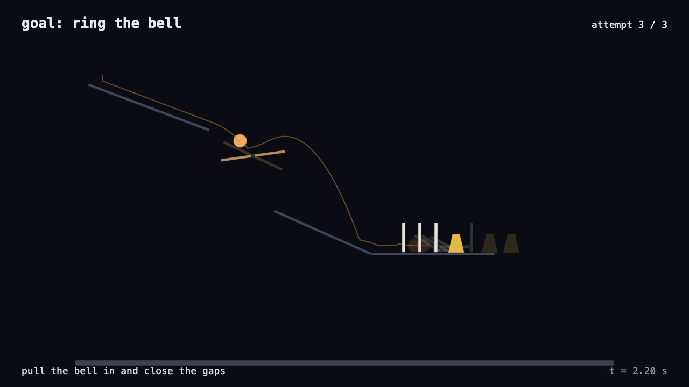

# goldberg-engine

A deterministic 2D physics engine for chain-reaction machines. You describe a machine as JSON, the engine runs it headless with a fixed timestep, and you get back a trace: who hit what, when (to the timestep), how hard, and where everything came to rest. The same run replays in a browser and records to an mp4 with sound.

[](media/example-reel.mp4)

This is the shared engine behind two agent demos: [Ring the Bell](https://github.com/abhaymettu/ring-the-bell) (an agent keeps redesigning a machine until a bell rings) and [The Tune Machine](https://github.com/abhaymettu/tune-machine) (marbles drop onto pitched bars and play a melody). This repo is only the engine, the renderer and the recorder. The clip above is the hand-made example reel: attempts 1 and 2 fail and stay behind as ghosts, attempt 3 rings the bell.


## What works

- **Level format** `goldberg-level/1`, documented in [docs/level-schema.md](docs/level-schema.md). The doc is generated from the same table the validator reads, and a test fails if it goes stale. `validateLevel` never throws; it returns one readable error per problem and rejects unknown fields.
- **Headless sim** on vendored planck.js (a Box2D port). Fixed timestep (default 1/240 s), no wall clock. The same level and seed give byte-identical traces and replay frames, in one process and across two separate Node processes (both tested).
- **Parts:** ball, marble, floor, ramp, domino, lever (seesaw on a pivot, optional angle limits), bell, bar (with a pitch), hopper (holds marbles, gate opens and closes on a schedule).
- **Events:** `contact`, `bell-rung`, `bar-hit` (with pitch, MIDI number and frequency), `gate-open`, `gate-close`, `out-of-bounds`. Each has a time that is an exact multiple of the timestep. A level can name a goal, and the trace says whether and when it was met.
- **Rest positions:** where every ball and marble stopped, when, and what it is touching.
- **Reels:** several attempts at one goal in one file. Failed attempts are kept as ghosts, the first success is the winner.
- **Browser renderer** (`renderer/`): plays a reel or a single replay. It types the goal, plays failed attempts fast and leaves them behind as faint ghosts with trails, plays the winning run at real speed with sound, then shows a caption with the real attempt count. It replays recorded frames; it never re-simulates, so what you see is the run that was judged.
- **Recorder** (`scripts/record.js`): steps the renderer frame by frame in headless Chromium, pipes the frames to ffmpeg, and muxes in audio synthesized from the logged hit events.

## Measured

- Analytic check: a ball dropped onto a bell rings it within one timestep of the free-fall time, at dt = 1/240, 1/480 and 1/1000 s.
- `examples/levels/ring-the-bell-easy.json`: the bell rings at t = 4.358333 s, hit by the third domino.
- `examples/levels/tune-four-notes.json`: bar hits at 1.133333, 1.633333, 2.133333 and 2.633333 s (C5 E5 G5 C6, exactly 0.5 s apart).
- The recorded example clip is 1280x720, 60 fps, 11.97 s, H.264 plus AAC, about 3 s to render on an M-series Mac. In the recorded tune clip, the audio onsets land at 2.733, 3.233, 3.733 and 4.233 s: the 1.6 s intro plus each logged hit time.
- `npm test`: 32 tests, all passing.

## Use

Requires Node 20+. Recording also needs ffmpeg and a headless Chromium (it finds Playwright's cached `chrome-headless-shell` on macOS, or set `CHROME_PATH`). `npm install` only pulls `playwright-core`, used for recording.

```sh
npm test
node bin/sim.js examples/levels/ring-the-bell-easy.json --events          # trace with events; exit 1 if the goal is not met, 3 if the level is invalid
node bin/sim.js examples/levels/tune-four-notes.json --out out/tune.replay.json
node bin/reel.js examples/attempts/ring-the-bell/reel.json --out out/ring-the-bell.reel.json
node scripts/record.js out/ring-the-bell.reel.json --out out/ring-the-bell.mp4
node bin/schema-doc.js --write                                             # regenerate docs/level-schema.md
```

To watch in a browser, serve the repo over HTTP (ES modules do not load from `file://`) and open `renderer/index.html?reel=<url of a reel or replay JSON>`, or drop a JSON file onto the page. Space pauses.

From code:

```js
import { validateLevel, simulate, onsets, buildReel } from "goldberg-engine";
const { trace, replay } = simulate(level, { seed: 1 });
trace.goal;    // { event, part, met, t, step } or null
trace.events;  // [{ type, t, step, ... }]
trace.rest;    // [{ part, x, y, restedAt, touching, outOfBounds }]
onsets(trace); // bar hits in time order
```

## Notes on determinism

- Contacts are detected on the state at the start of each step, so a reported time can lead the true touch by at most one `dt`.
- The seed only matters through `world.jitter` (default 0). With jitter at 0, every seed gives the same run; a test checks this.
- Determinism is promised for one engine version on one JavaScript engine. The renderer never re-simulates, so browser and Node never need to agree.

## Not built

- Nothing here proposes or edits machines; the agents live in [ring-the-bell](https://github.com/abhaymettu/ring-the-bell) and [tune-machine](https://github.com/abhaymettu/tune-machine).
- A piano roll, and the bucket, string and hammer parts from the original proposal.

## Vendored code

`vendor/planck/` is [planck.js](https://github.com/piqnt/planck.js) 1.5.1, MIT licensed, unmodified, with its license. `vendor/planck/SHA256` holds the SHA-256 of all three files; see `vendor/planck/VENDORED.md`.
